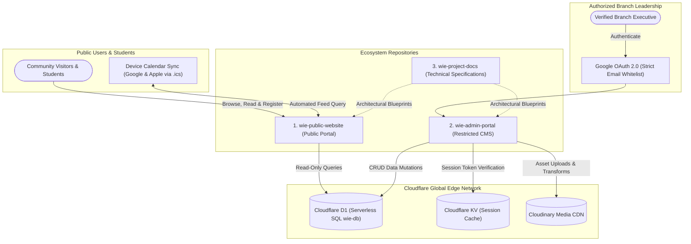

# 💜 IEEE WIE Al-Huson — Project Architecture & System Documentation

[](https://ieee-wie-alhuson.pages.dev)
[](https://github.com/ieee-alhuson-wie)
[](https://github.com/SalehAlSalem)
[](LICENSE)

Welcome to the primary technical documentation repository for the **IEEE Women in Engineering (WIE) Student Affinity Group at Al-Huson University College (Al-Balqa Applied University)**. 

This ecosystem was engineered by **[Saleh Al-Salem](https://github.com/SalehAlSalem)** using a modern, decoupled, cloud-native architecture designed to establish permanent digital independence, maximize security, and deliver sub-second response times across the globe with **zero operational infrastructure costs**.

---

## 🏗️ System Architecture & Data Flow

The platform separates read-intensive public traffic from administrative write mutations across three distinct repositories to enforce clear boundaries of concern and eliminate attack surfaces:



---

## 📦 The 3 Ecosystem Repositories

| Repository | Visibility | Focus & Scope | Core Stack |
| :--- | :--- | :--- | :--- |
| **[`wie-project-docs`](https://github.com/ieee-alhuson-wie/wie-project-docs)** | `Public` | Architectural specifications, setup guides, and engineering standards. | Markdown, Mermaid |
| **[`wie-public-website`](https://github.com/ieee-alhuson-wie/wie-public-website)** | `Private / Public` | Interactive public-facing portal for students, event discovery, and honors. | Astro 5, React 19, Tailwind CSS v4 |
| **[`wie-admin-portal`](https://github.com/ieee-alhuson-wie/wie-admin-portal)** | `Private` | Protected headless administrative suite for executive committee members. | Astro 5, Auth.js, Google OAuth, D1 |

---

## 🔐 Security Standards & Isolation Boundaries

1. **Strict Read/Write Boundary Separation:**
   * `wie-public-website` holds **read-only privileges** to the underlying database (`wie-db`). It possesses zero secret keys, write credentials, or mutation APIs.
   * All state-altering operations (Insert, Update, Delete) are strictly quarantined within the `wie-admin-portal`.

2. **Dual-Layer Identity Verification:**
   * Administrative access requires Google OAuth 2.0 authentication.
   * Identity verification is guarded by a **Dual-Layer Whitelist**:
     * **Layer 1 (Auth Configuration):** Token issuance is blocked for non-whitelisted Google accounts.
     * **Layer 2 (Edge Middleware):** Real-time interceptor (`middleware.ts`) that immediately destroys cookies and redirects unverified sessions to `/signout`.

3. **Zero Local Storage Overhead:**
   * No files or binary images are persisted on local disks or git commits. Media assets are processed, optimized, and served through Cloudinary CDN.

---

## ☁️ Cloud Infrastructure & Services

| Service | Role & Functionality |
| :--- | :--- |
| **Cloudflare Pages** | Multi-region global serverless deployment with edge rendering (SSR). |
| **Cloudflare D1** | Serverless relational SQL database engine providing ACID compliance for events and leadership records. |
| **Cloudflare KV** | Low-latency key-value storage engine powering administrative session handling. |
| **Cloudinary** | Responsive image delivery, automated format conversion (WebP/AVIF), and CDN caching. |
| **Google Cloud Identity** | Enterprise OAuth 2.0 identity federation service. |

---

## 💻 Local Development Workflow

### 1. Running the Public Portal (`wie-public-website`)
```bash
git clone https://github.com/ieee-alhuson-wie/wie-public-website.git
cd wie-public-website
npm install
npm run dev
# Server available at http://localhost:4321
```

### 2. Running the Administrative Portal (`wie-admin-portal`)
```bash
git clone https://github.com/ieee-alhuson-wie/wie-admin-portal.git
cd wie-admin-portal
npm install
# Configure your local environment variables in .env
npm run dev
# Server available at http://localhost:5173
```

---

## 👥 Authors & Leadership

This project was engineered as a voluntary technical initiative dedicated to advancing the IEEE student community at Al-Huson University College:

* **[Saleh Al-Salem](https://github.com/SalehAlSalem)** — Lead Software Engineer & System Architect
  * *Conceived and engineered 100% of the full-stack codebase, cloud edge infrastructure, database architecture, authentication security, calendar synchronization pipelines, and founded the GitHub organization.*
* **Noor Al-Zoubi** — Project Initiator & IEEE WIE Al-Huson Chair
  * *Initiated the project vision, defined community operational requirements, consolidated records, and led user acceptance testing.*
* **Raghad Obeidat** — Content & UI Advisor
  * *Assisted in content auditing, copywriting, and interface design alignment.*

---

## 📄 License

Distributed under the **MIT License**. Created with excellence for **IEEE WIE Al-Huson**.
