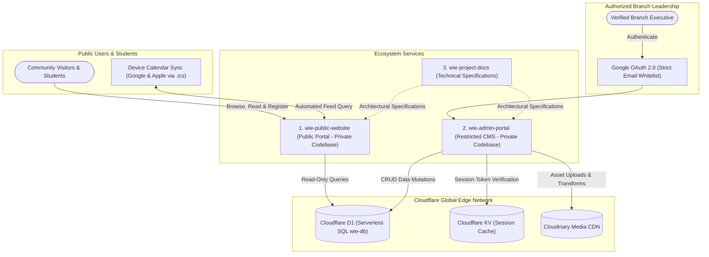

# 💜 IEEE WIE Al-Huson — Project Architecture & System Documentation

Welcome to the primary technical documentation repository for the **IEEE Women in Engineering (WIE) Student Affinity Group at Al-Huson University College (Al-Balqa Applied University)**. 

This platform was designed and engineered by **[Saleh Al-Salem](https://github.com/SalehAlSalem)** using a custom, closed-source, cloud-native architecture built to establish permanent digital autonomy, ensure strict data privacy, and deliver ultra-low latency worldwide with **zero monthly infrastructure costs**.

> 🔒 **Notice:** All source code and system implementations across the platform's core services are **Private & Proprietary Software**. This repository exists exclusively for architectural transparency, operational documentation, and system specifications.

---

## 🏗️ System Architecture & Data Flow

The platform decouples public read traffic from administrative write mutations across dedicated private services to maximize security boundaries:

---

## 📦 Service Breakdown & Repository Access

| Service / Repository | Access Level | Description | Core Stack |
| :--- | :--- | :--- | :--- |
| **[`wie-project-docs`](https://github.com/ieee-alhuson-wie/wie-project-docs)** | `Public` | Architectural specifications, blueprints, and system documentation. | Markdown, Mermaid |
| **`wie-public-website`** | `Private 🔒` | High-performance student & community portal. | Astro 5, React 19, Tailwind CSS v4 |
| **`wie-admin-portal`** | `Private 🔒` | Headless management dashboard and secure administrative API. | Astro 5, Auth.js, Google OAuth, D1 |

---

## 🔐 Security Standards & Isolation Boundaries

1. **Private & Protected Codebases:**
   * The underlying source code for both the client portal and the administration suite is stored within **restricted, private repositories** to protect proprietary algorithms, schema blueprints, and internal API designs.

2. **Strict Read/Write Privilege Separation:**
   * The public portal operates with **read-only privileges** against the edge database (`wie-db`). It contains zero secret tokens, write permissions, or state-altering APIs.
   * All database mutations (Create, Update, Delete) are strictly isolated within the authenticated admin portal.

3. **Dual-Layer Identity Verification:**
   * Access to administrative controls is restricted to authorized branch executives via **Google OAuth 2.0**.
   * Identity verification is guarded by a two-stage filter:
     * **Stage 1 (Token Authorization):** Hardcoded email whitelist check during the OAuth callback.
     * **Stage 2 (Edge Middleware):** Real-time interceptor (`middleware.ts`) that wipes cookies and terminates sessions for non-whitelisted identities immediately.

4. **Zero-Trust Media & Secret Handling:**
   * Sensitive secrets and API keys are managed exclusively via encrypted cloud environment variables.
   * No images or static assets are persisted to server disks; all media is processed and served through Cloudinary CDN.

---

## ☁️ Cloud Infrastructure & Edge Services

| Service | Architecture Role |
| :--- | :--- |
| **Cloudflare Pages** | Multi-region global serverless deployment with edge rendering (SSR). |
| **Cloudflare D1** | Serverless relational SQL database engine providing ACID transactions for activities, metrics, and leaders. |
| **Cloudflare KV** | Low-latency distributed key-value store for session token tracking. |
| **Cloudinary** | Dynamic asset optimization, automatic WebP/AVIF transformations, and global media delivery. |
| **Google Cloud Identity** | Enterprise OAuth 2.0 authentication provider. |

---

## 👥 Authors & System Attribution

This platform was developed as a voluntary initiative to deliver an enterprise-grade digital home for the IEEE student branch:

* **[Saleh Al-Salem](https://github.com/SalehAlSalem)** — Lead Software Engineer & System Architect
  * *Single-handedly designed, programmed, and deployed 100% of the proprietary full-stack codebase, cloud edge architecture, database models, security barriers, calendar synchronization systems, and founded the GitHub organization.*
* **Noor Al-Zoubi** — Project Initiator & IEEE WIE Al-Huson Chair
  * *Initiated the project vision, defined operational requirements, collected historical branch data, and coordinated user acceptance testing.*
* **Raghad Obeidat** — Content & UI Advisor
  * *Contributed to content curation, text auditing, and provided design alignment feedback.*

---

## ⚖️ Copyright & Intellectual Property

**Copyright © 2026 Saleh Al-Salem. All Rights Reserved.**

All source code, software architecture designs, custom database schemas, and proprietary implementations are the intellectual property of **Saleh Al-Salem**. The codebases are private and closed-source. Unauthorized reproduction, distribution, decompilation, or deployment of any portion of the source code without explicit written consent is strictly prohibited.
